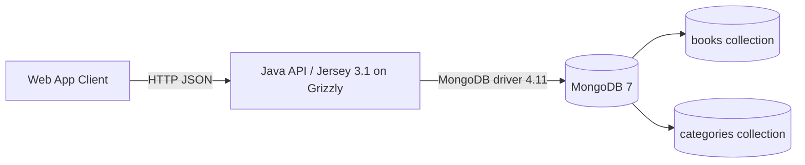
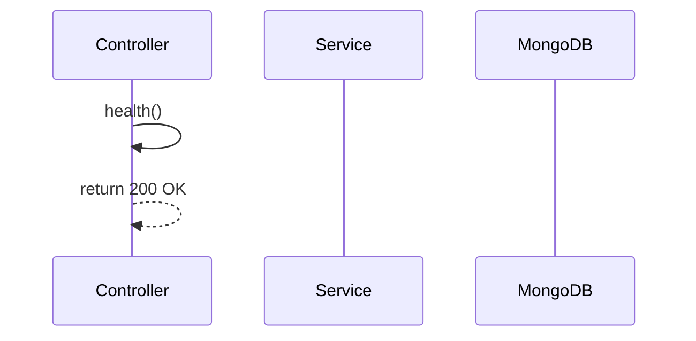
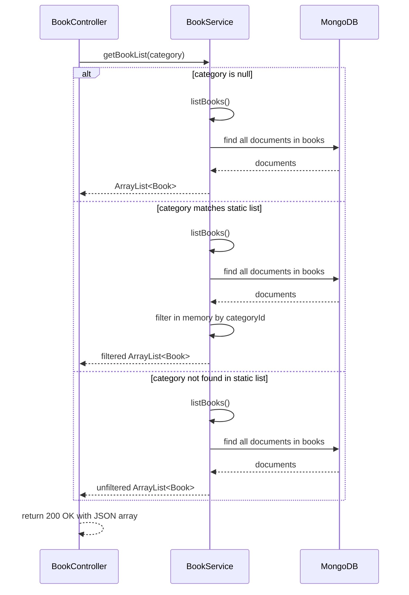
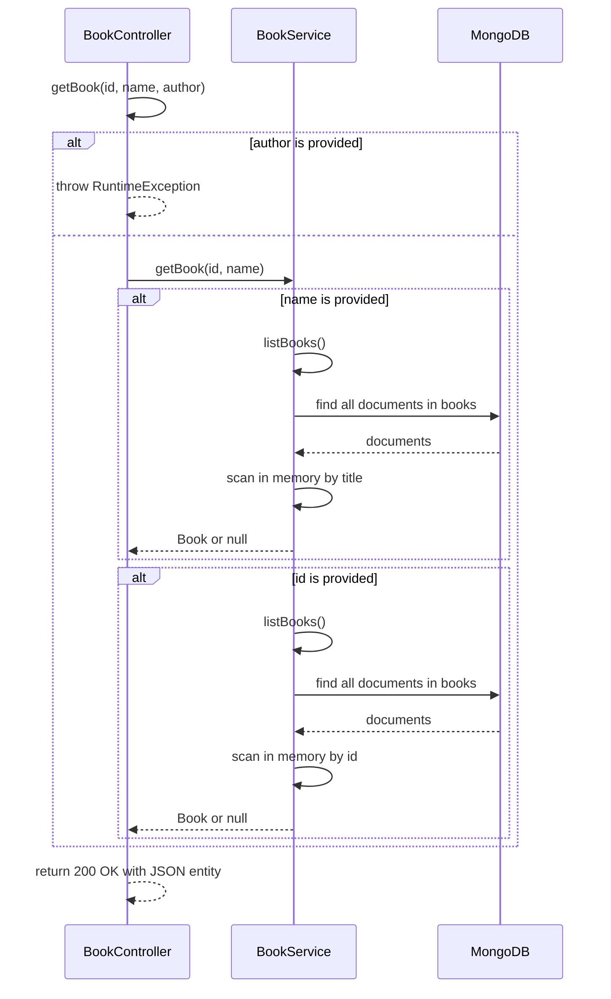
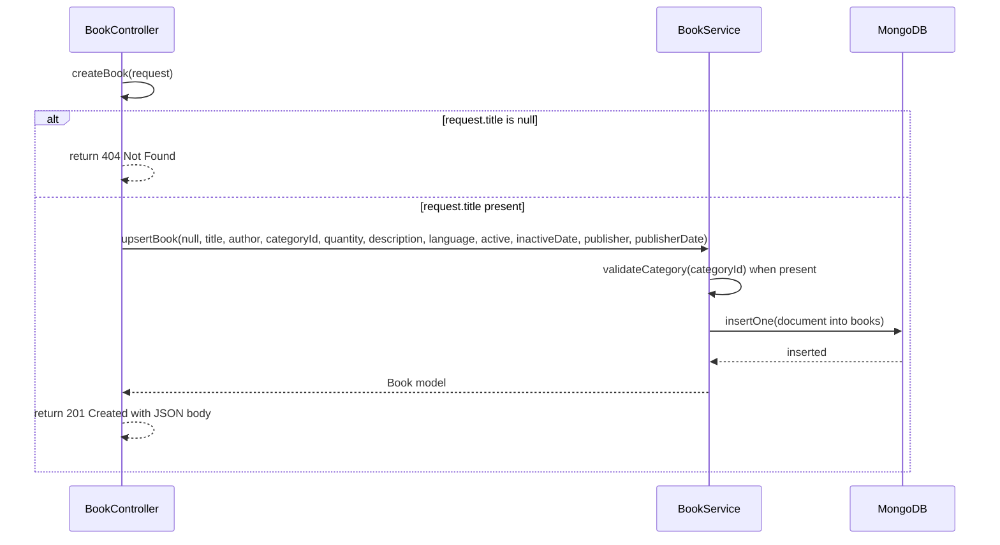
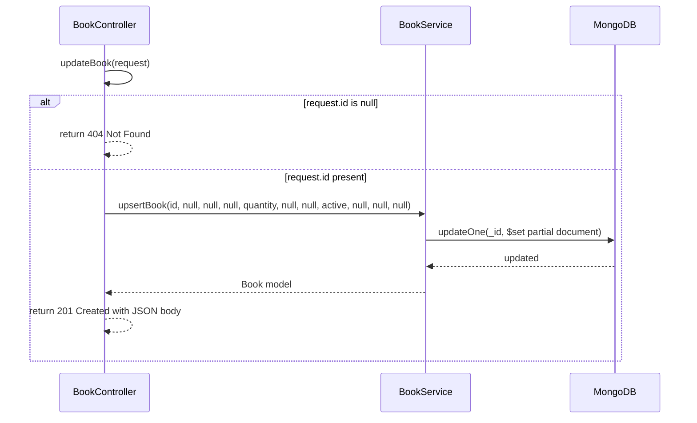

# Legacy Java API Technical Documentation

## High Level Design

### System context

This repository contains a small Java REST API for a bookstore domain. It sits between a web application client and MongoDB 7.

- The client calls the API over HTTP.
- The API is a Jersey 3.1 application running on Grizzly.
- MongoDB stores book data in the `books` collection.
- MongoDB is also initialized with a `categories` collection, but the application does not read that collection at runtime.



### Technology stack

The repository declares and/or uses the following stack:

- Java 11 (`pom.xml:11-12`)
- Jakarta REST / JAX-RS 3.1 (`pom.xml:21-24`)
- Jersey 3.1.0 on Grizzly (`pom.xml:27-41`, `src/main/java/com/bookstore/BookstoreApp.java:5-8,17-21`)
- JSON-B via Jersey JSON binding (`pom.xml:37-41`, `src/main/java/com/bookstore/BookstoreApp.java:7,18`)
- MongoDB synchronous driver 4.11.0 (`pom.xml:43-48`)
- JUnit 5.9.0 (`pom.xml:57-63`)
- Mockito 5.12.0 (`pom.xml:64-75`)
- JaCoCo 0.8.10 (`pom.xml:94-109`)
- Maven Shade plugin for the executable fat JAR (`pom.xml:110-129`)
- Docker multi-stage build (`Dockerfile:1-14`)
- Docker Compose with a bridge network and persistent MongoDB volume (`docker-compose.yml:1-33`)

### Deployment and runtime

#### Ports and network

- The API listens on port `8080` inside the container and is published as `8080:8080` by Docker Compose (`Dockerfile:13`, `docker-compose.yml:10-13`).
- MongoDB listens on port `27017` and is published as `27017:27017` (`docker-compose.yml:19-25`).
- Both services are attached to the `bookstore-network` bridge network (`docker-compose.yml:27-29`).

#### Volumes and initialization

- MongoDB data is persisted in the named volume `mongodb-data` mounted at `/data/db` (`docker-compose.yml:21-23`, `docker-compose.yml:31-33`).
- The init script `mongo-init/01-init-bookstore.js` is mounted read-only into `/docker-entrypoint-initdb.d/` so it runs on first container startup (`docker-compose.yml:21-23`).
- The init script creates the `categories` collection and inserts six static categories, then creates a unique index on `id` (`mongo-init/01-init-bookstore.js:1-15`).

#### Runtime configuration

- The application hardcodes its base URI to `http://0.0.0.0:8080/api/` (`src/main/java/com/bookstore/BookstoreApp.java:15-22`).
- `docker-compose.yml` defines `MONGODB_URI=mongodb://mongodb:27017`, but the service code does not read that environment variable (`docker-compose.yml:8-9`, `src/main/java/com/bookstore/service/BookService.java:14-18`).
- The application starts by registering JSON-B and the `BookController` resource, then creates a Grizzly HTTP server (`src/main/java/com/bookstore/BookstoreApp.java:17-22`).
- There is no graceful shutdown handling in the bootstrap class (`src/main/java/com/bookstore/BookstoreApp.java:21-24`).

#### Local run

The intended local runtime is:

1. Build and start the stack with Docker Compose.
2. The API comes up on `http://localhost:8080/api/`.
3. MongoDB comes up on `mongodb://localhost:27017`.

The repository does not contain a separate script for local development outside Docker. The build path is the multi-stage Dockerfile, which compiles with Maven and runs the shaded JAR (`Dockerfile:1-14`).

## Low Level Design

### Project structure and responsibilities

```text
src/main/java/com/bookstore
├── BookstoreApp.java
│   └── Boots the Grizzly HTTP server and registers Jersey resources.
├── controller
│   ├── BookController.java
│   │   └── Exposes HTTP endpoints for health checks and book operations.
│   ├── CreateBookDTO.java
│   │   └── Request body for creating books.
│   └── UpdateBookDTO.java
│       └── Request body for updating books.
├── model
│   ├── Book.java
│   │   └── In-memory and JSON representation of a book document.
│   └── Category.java
│       └── Static category catalog duplicated in code.
└── service
	└── BookService.java
		└── MongoDB access and book business logic.
```

### Call graph

The code has one clear service boundary:

- `BookController` constructs `BookService` directly (`src/main/java/com/bookstore/controller/BookController.java:12-20`).
- The controller calls `BookService.getBookList`, `getBook`, and `upsertBook` (`src/main/java/com/bookstore/controller/BookController.java:28-91`).
- `BookService` talks to MongoDB through the synchronous driver (`src/main/java/com/bookstore/service/BookService.java:53-78,101-133`).

### Endpoints and request flow

#### GET `/api/books/health`

Purpose: health probe.

Flow:



This endpoint bypasses the service layer and the database.

#### GET `/api/books?category={name}`

Purpose: list books, optionally filtered by category name.

Flow:



Observed behavior:

- Filtering is performed in memory after loading the entire collection (`src/main/java/com/bookstore/service/BookService.java:26-50`).
- Category lookup uses the static list in `Category.STATIC_CATEGORIES` (`src/main/java/com/bookstore/model/Category.java:10-19`).

#### GET `/api/books/single?id={id}&name={title}&author={author}`

Purpose: return a single book by title or id.

Flow:



Observed behavior:

- `author` is not implemented and causes an uncaught `RuntimeException` (`src/main/java/com/bookstore/controller/BookController.java:38-45`).
- `getBook` loads the whole collection and scans in memory (`src/main/java/com/bookstore/service/BookService.java:149-173`).
- The id comparison uses `==` instead of `.equals`, so id lookup is effectively broken (`src/main/java/com/bookstore/service/BookService.java:162-168`).

#### POST `/api/books`

Purpose: create a book.

Flow:



Observed behavior:

- Validation is minimal: only `title != null` is checked in the controller (`src/main/java/com/bookstore/controller/BookController.java:74-91`).
- Missing title returns `404 Not Found`, which is semantically incorrect for request validation.
- `CreateBookDTO.categoryId` is a `String`, while `Book.categoryId` is an `int` (`src/main/java/com/bookstore/controller/CreateBookDTO.java:5-18`, `src/main/java/com/bookstore/model/Book.java:5-18`).
- `BookService.upsertBook` converts the category name to an integer id using the static category list (`src/main/java/com/bookstore/service/BookService.java:81-99,139-147`).

#### PUT `/api/books`

Purpose: update a book.

Flow:



Observed behavior:

- Missing id returns `404 Not Found`, again using a status code that does not express validation failure (`src/main/java/com/bookstore/controller/BookController.java:48-69`).
- Successful update returns `201 Created`, but the request is an update, not a create (`src/main/java/com/bookstore/controller/BookController.java:51-66`).
- The update path only writes `quantity`, `active`, and `inactiveDate` back to MongoDB (`src/main/java/com/bookstore/service/BookService.java:121-133`).

### Data model

#### `books` collection

The application reads and writes documents with the following fields (`src/main/java/com/bookstore/service/BookService.java:58-74,105-130`):

- `_id`: MongoDB `ObjectId` in the database; serialized as a hex string in `Book.id`
- `title`: string
- `author`: string
- `categoryId`: integer
- `quantity`: integer
- `description`: string
- `language`: string
- `active`: boolean
- `inactiveDate`: date
- `publisher`: string
- `publisherDate`: date

`Book` mirrors those fields as Java properties (`src/main/java/com/bookstore/model/Book.java:5-18`).

#### `categories` collection

The `mongo-init` script creates and seeds a `categories` collection with six static documents, but the runtime code does not query that collection (`mongo-init/01-init-bookstore.js:4-15`). The same category list is also hardcoded in `Category.STATIC_CATEGORIES` (`src/main/java/com/bookstore/model/Category.java:10-19`).

This means categories are duplicated in two places:

- code
- database seed

### Error handling

There is no application-wide exception mapper.

Observed consequences:

- An uncaught `RuntimeException` from `/api/books/single` will surface as HTTP 500 (`src/main/java/com/bookstore/controller/BookController.java:38-45`).
- Validation failures are mapped to `404 Not Found` instead of `400 Bad Request` (`src/main/java/com/bookstore/controller/BookController.java:66-68,89-90`).
- Successful updates return `201 Created` instead of a 2xx update status such as `200 OK` or `204 No Content` (`src/main/java/com/bookstore/controller/BookController.java:51-66`).
- The `health` endpoint always returns `200 OK` regardless of any backend dependency state because it does not check the service or MongoDB (`src/main/java/com/bookstore/controller/BookController.java:22-26`).

### Current test coverage estimate

The workspace does not expose any visible `src/test` files through repository search, so there is no verifiable automated coverage in this snapshot.

If the intended test suite is a single happy-path create test, then the effective coverage is still very low:

- it would cover only the POST create path,
- it would not cover list, single lookup, update, error handling, bootstrap, or MongoDB filtering,
- it would not catch the id comparison bug, the status-code misuse, or the environment-variable issue.

A reasonable estimate is: **minimal functional coverage, likely below 10% of the observable behavior**.

## Technical debt and risks

| Issue | Evidence | Impact | Suggested .NET migration fix |
|---|---|---|---|
| A new `MongoClient` is created on every call instead of a shared pooled client | `src/main/java/com/bookstore/service/BookService.java:53-57,101-103,119-133` | Wastes connections and prevents proper pooling | Register a singleton Mongo client / `IMongoClient` in DI and reuse it across repository instances |
| Filtering by category, title, and id loads the full collection into memory instead of querying MongoDB | `src/main/java/com/bookstore/service/BookService.java:23-50,149-173` | Poor performance and unnecessary data transfer | Replace in-memory scans with server-side filters (`Find`, `Filter.Eq`, indexes) in the .NET data layer |
| String comparison with `==` in `getBook`, so lookup by id never works | `src/main/java/com/bookstore/service/BookService.java:162-168` | Id lookup is broken for reference inequality | Use value comparison in the migrated API and add tests for id lookup |
| Hardcoded Mongo URI and base URL; `MONGODB_URI` in docker-compose is ignored | `src/main/java/com/bookstore/service/BookService.java:15-18`, `src/main/java/com/bookstore/BookstoreApp.java:15-22`, `docker-compose.yml:8-9` | Environment-specific configuration cannot be changed without code edits | Move connection strings and base URLs to configuration and bind them through .NET options |
| No dependency injection; the controller instantiates `BookService`, no validation, no logging, no graceful shutdown | `src/main/java/com/bookstore/controller/BookController.java:12-20`, `src/main/java/com/bookstore/BookstoreApp.java:21-24` | Hard to test, hard to observe, hard to shut down cleanly | Use ASP.NET Core DI, request validation, structured logging, and host lifetime hooks |
| Categories are hardcoded in code and duplicated in the database | `src/main/java/com/bookstore/model/Category.java:10-19`, `mongo-init/01-init-bookstore.js:1-15` | Source of truth is split and can drift | Choose one source of truth in the .NET migration: seeded lookup table or configuration-backed catalog |
| A single test covering only the happy path of create would leave most behavior untested | `src/test/java/com/bookstore/controller/BookControllerTest.java:16-84` contains only `testCreateBookSuccess`, which exercises `BookController.createBook` with a mocked `BookService` on the happy path | Regression risk remains high; estimated current line coverage is minimal, with `BookService`, MongoDB access, and every other endpoint untested, likely below 10% of observable behavior | Add tests for list, single lookup, update, validation, and failure paths in the .NET suite |

## Migration notes: preserve versus fix

### Preserve

- Keep the external base path shape `/api/...` unless a product decision says otherwise.
- Keep the `books` and `categories` domain concepts.
- Keep the MongoDB-backed persistence model for `books`.
- Keep the static category names only if the business confirms they are intended to remain fixed. **needs Product Owner decision**

### Fix

- Replace hardcoded configuration with environment-based configuration.
- Replace in-memory filtering with database queries.
- Replace direct instantiation with DI.
- Replace uncaught exceptions with explicit error handling and proper status codes.
- Replace the `201 Created` update response with an update-appropriate status code.
- Resolve the `categoryId` type mismatch between request DTOs and persisted documents.
- Decide whether lookup by id, title, and category should remain all supported. **needs Product Owner decision**
- Decide whether `author` filtering should be implemented or removed. **needs Product Owner decision**
- Remove the duplicated category source of truth. **needs Product Owner decision**
